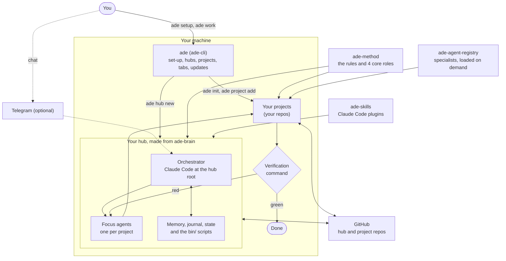

# better-ade

**ADE: verified, not vibed.** AI agents do the work; it counts as done only when the tests pass.
Website: [ade.ardata.tech](https://ade.ardata.tech/).

Where it fits: [ade](https://github.com/better-ade/ade-cli) is the command, [ade-brain](https://github.com/better-ade/ade-brain)
the hub, [ade-method](https://github.com/better-ade/ade-method) the rules, [ade-skills](https://github.com/better-ade/ade-skills)
the skills, [ade-secrets](https://github.com/better-ade/ade-secrets) the keys, [ade-terminal](https://github.com/better-ade/ade-terminal)
the desktop app, and ade-computer (private for now) an isolated Ubuntu desktop with ADE installed.

## Start

```bash
curl -fsSL https://raw.githubusercontent.com/better-ade/ade-cli/main/install.sh | bash   # ade, the tagged release
ade setup                                                                                  # the guide, one step at a time
```

`ade setup` installs Claude Code, signs you in to Claude and GitHub, makes your hub from ade-brain, and starts a guided
first session; Telegram is optional. In a project of your own, without a hub: `ade init`.

## The stack



Alongside, each usable on its own: [ade-terminal](https://github.com/better-ade/ade-terminal), the desktop app;
[ade-secrets](https://github.com/better-ade/ade-secrets), a local key store; and
[ade-drill](https://github.com/better-ade/ade-drill), which runs every repo's checks at main each night.

## The repos

| Repo | What it is | Release |
|---|---|---|
| [ade-cli](https://github.com/better-ade/ade-cli) | The `ade` command: set-up, the workspace of tabs, hub and project commands, updates | 0.2.16 |
| [ade-brain](https://github.com/better-ade/ade-brain) | The hub template: the orchestrator, memory, journal, Telegram and the `bin/` scripts | 1.0.0 |
| [ade-method](https://github.com/better-ade/ade-method) | The rules every agent works by, the four core roles and the BMAD v6 settings | 2.2.0 |
| [ade-agent-registry](https://github.com/better-ade/ade-agent-registry) | Specialist agents, each loaded only when a task needs one | 1.1.0 |
| [ade-skills](https://github.com/better-ade/ade-skills) | A Claude Code plugin marketplace: git, browser, notes, trackers, the guard | 0.10.0 |
| [ade-secrets](https://github.com/better-ade/ade-secrets) | A local key store and terminal vault that refuses to run inside an agent session | 0.3.1 |
| [ade-terminal](https://github.com/better-ade/ade-terminal) | The ADE desktop app for macOS and Linux | 0.25.1 |
| [ade-drill](https://github.com/better-ade/ade-drill) | Nightly drills: every suite at main, cross-repo checks, the golden path | 0.1.0 |
| [ade-website](https://github.com/better-ade/ade-website) | The website | |
| [.github](https://github.com/better-ade/.github) | Shared CI and release workflows, and the PR and commit templates | |
